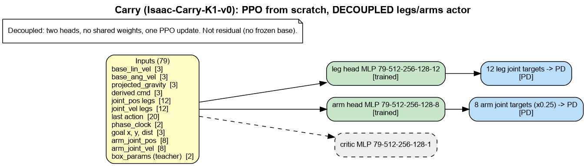

# carry: models, inputs and reward terms

Generated by `isaac_tasks/k1_velocity/scripts/task_docs.py`. Re-run after changing rewards.

Legend: green = trained, grey = frozen, orange = command to a frozen base, pink = residual added to the frozen base's legs, blue = joint targets to PD, purple = arm IK.

## Carry (Isaac-Carry-K1-v0): PPO from scratch, DECOUPLED legs/arms actor

Decoupled: two heads, no shared weights, one PPO update. Not residual (no frozen base).

### Reward terms

Source: run `p7_carry` params/env.yaml (what the run trained with). Episode 20.0 s, policy dt 0.020 s. Isaac Lab multiplies every weight by dt; `Episode_Reward/<term>` in TensorBoard is the episode sum divided by the episode length in seconds.

| term | weight | function | params | what it computes (docstring) |
|---|---|---|---|---|
| `track_lin_vel_xy_exp` | 10.0 | `track_lin_vel_xy_exp_weighted` (agile_rewards) | gated(track_lin_vel_xy_exp_weighted, command_name=base_velocity, std=0.15) | AGILE ``track_lin_vel_xy_yaw_frame_exp_weighted_simplified``. |
| `track_ang_vel_z_exp` | 5.0 | `track_ang_vel_z_world_exp_weighted` (agile_rewards) | gated(track_ang_vel_z_world_exp_weighted, command_name=base_velocity, std=0.25) | AGILE ``track_ang_vel_z_world_exp_weighted_simplified``. |
| `base_height` | 2.0 | `base_height_exp` (gait_rewards) | target_height=0.57, std=0.1, sensor_cfg=None, asset_cfg=robot | Positive reward for holding the trunk at ``target_height`` (AGILE). |
| `flat_orientation_l2` | -5.0 | `flat_orientation_l2` (rewards) | asset_cfg=robot[Trunk] | Squared xy of projected gravity (trunk tilt). Penalty. |
| `termination_penalty` | -200.0 | `is_terminated` (rewards) |  | 1 on ANY termination except time-out. Penalty. |
| `feet_slide` | -0.25 | `feet_slide` (rewards) | sensor_cfg=contact_forces[left_foot_link,right_foot_link], asset_cfg=robot[left_foot_link,right_foot_link] | Foot xy speed while the foot is in contact. Penalty. |
| `feet_roll` | -0.1 | `feet_roll_l2` (gait_rewards) | asset_cfg=robot[left_foot_link,right_foot_link] | Squared foot roll -- keeps the sole flat instead of toe-walking (AGILE ``feet_roll``). |
| `feet_yaw_diff` | -0.2 | `feet_yaw_diff_l2` (gait_rewards) | asset_cfg=robot[left_foot_link,right_foot_link] | Squared difference between the two feet's world yaw (AGILE ``feet_yaw_diff``). |
| `feet_yaw_mean` | -4.0 | `feet_yaw_mean_vs_base` (gait_rewards) | feet_asset_cfg=robot[left_foot_link,right_foot_link], base_body_cfg=robot[Trunk] | Penalise feet that drift out of the base's heading (AGILE ``feet_yaw_mean``). |
| `feet_distance` | -0.2 | `feet_distance_from_ref` (gait_rewards) | ref_distance=0.2, asset_cfg=robot[left_foot_link,right_foot_link] | Squared error of the two feet's horizontal separation from ``ref_distance``. |
| `ankle_torques` | -0.0001 | `joint_torques_l2` (rewards) | asset_cfg=robot[(?i).*_Ankle_.*] | Squared joint torques on the selected joints. Penalty. |
| `dof_vel` | -0.0002 | `joint_vel_l2` (rewards) | asset_cfg=robot | Squared joint velocities. Penalty. |
| `jumping` | -0.5 | `jumping` (agile_rewards) | threshold=1.0, sensor_cfg=contact_forces[left_foot_link,right_foot_link] | AGILE ``jumping`` -- penalise both feet leaving the ground at once. |
| `lin_vel_z_l2` | -0.5 | `lin_vel_z_l2` (rewards) |  | Squared vertical trunk velocity. Penalty. |
| `ang_vel_xy_l2` | -0.5 | `ang_vel_xy_l2` (rewards) |  | Squared roll/pitch rate of the trunk. Penalty. |
| `action_rate_l2` | -0.1 | `action_rate_l2` (rewards) |  | Squared change of the action between steps. Penalty. |
| `action_jerk_l2` | -0.01 | `action_jerk_l2` (gait_rewards) | asset_cfg=robot[Left_Hip_Pitch,Left_Hip_Roll,Left_Hip_Yaw,Left_Knee_Pitch,Left_Ankle_Pitch,Left_Ankle_Roll,Right_Hip_Pitch,Right_Hip_Roll,Right_Hip_Yaw,Right_Knee_Pitch,Right_Ankle_Pitch,Right_Ankle_Roll] | Squared third difference of the joint targets -- an explicit jerk penalty. |
| `dof_acc_l2` | -2.5e-07 | `joint_acc_l2` (rewards) | asset_cfg=robot[Left_Hip_Pitch,Left_Hip_Roll,Left_Hip_Yaw,Left_Knee_Pitch,Left_Ankle_Pitch,Left_Ankle_Roll,Right_Hip_Pitch,Right_Hip_Roll,Right_Hip_Yaw,Right_Knee_Pitch,Right_Ankle_Pitch,Right_Ankle_Roll] | Squared joint accelerations. Penalty. |
| `dof_torques_l2` | -0.0001 | `joint_torques_l2` (rewards) | asset_cfg=robot[Left_Hip_Pitch,Left_Hip_Roll,Left_Hip_Yaw,Left_Knee_Pitch,Left_Ankle_Pitch,Left_Ankle_Roll,Right_Hip_Pitch,Right_Hip_Roll,Right_Hip_Yaw,Right_Knee_Pitch,Right_Ankle_Pitch,Right_Ankle_Roll] | Squared joint torques on the selected joints. Penalty. |
| `ankle_roll_torques` | -0.002 | `joint_torques_l2` (rewards) | asset_cfg=robot[.*_Ankle_Roll] | Squared joint torques on the selected joints. Penalty. |
| `dof_pos_limits` | -1.0 | `joint_pos_limits` (rewards) | asset_cfg=robot[Left_Hip_Pitch,Left_Hip_Roll,Left_Hip_Yaw,Left_Knee_Pitch,Left_Ankle_Pitch,Left_Ankle_Roll,Right_Hip_Pitch,Right_Hip_Roll,Right_Hip_Yaw,Right_Knee_Pitch,Right_Ankle_Pitch,Right_Ankle_Roll] | Joint positions beyond soft limits. Penalty. |
| `dof_vel_limits` | -1.0 | `joint_vel_limits` (rewards) | soft_ratio=0.9, asset_cfg=robot[Left_Hip_Pitch,Left_Hip_Roll,Left_Hip_Yaw,Left_Knee_Pitch,Left_Ankle_Pitch,Left_Ankle_Roll,Right_Hip_Pitch,Right_Hip_Roll,Right_Hip_Yaw,Right_Knee_Pitch,Right_Ankle_Pitch,Right_Ankle_Roll] | Joint velocities beyond soft limits. Penalty. |
| `torque_limits` | -0.01 | `applied_torque_limits` (rewards) | asset_cfg=robot[Left_Hip_Pitch,Left_Hip_Roll,Left_Hip_Yaw,Left_Knee_Pitch,Left_Ankle_Pitch,Left_Ankle_Roll,Right_Hip_Pitch,Right_Hip_Roll,Right_Hip_Yaw,Right_Knee_Pitch,Right_Ankle_Pitch,Right_Ankle_Roll] | Gap between computed and applied (clipped) torque. Penalty. |
| `body_acc_l2` | -2e-05 | `body_lin_acc_l2` (rewards) | asset_cfg=robot | Squared linear acceleration of the selected bodies. Penalty. |
| `joint_deviation_arms` | -0.5 | `joint_deviation_l1` (rewards) | asset_cfg=robot[ALeft_Shoulder_Pitch,Left_Shoulder_Roll,Left_Elbow_Pitch,Left_Elbow_Yaw,ARight_Shoulder_Pitch,Right_Shoulder_Roll,Right_Elbow_Pitch,Right_Elbow_Yaw] | Isaac Lab built-in. |
| `gait_cadence` | -0.2 | `gait_cadence_penalty` (gait_rewards) | target_hz=2.0, dt=0.02, asset_cfg=robot[Left_Hip_Pitch,Left_Hip_Roll,Left_Hip_Yaw,Left_Knee_Pitch,Left_Ankle_Pitch,Left_Ankle_Roll,Right_Hip_Pitch,Right_Hip_Roll,Right_Hip_Yaw,Right_Knee_Pitch,Right_Ankle_Pitch,Right_Ankle_Roll] | Penalise step frequency far from ``target_hz``. |
| `phase_locked_stride` | -4.0 | `phase_locked_stride` (gait_rewards) | target_stride=0.22, asset_cfg=robot[left_foot_link,right_foot_link], base_body_cfg=robot[Trunk] | Penalise fore-aft foot placement that disagrees with the gait clock. |
| `phase_swing` | -0.4 | `phase_synced_swing` (gait_rewards) | contact_cfg=contact_forces[left_foot_link,right_foot_link] | Penalise each foot being grounded during its swing window and vice versa. |
| `feet_clearance` | -1.6 | `feet_clearance` (gait_rewards) | target_lift=0.06, contact_cfg=contact_forces[left_foot_link,right_foot_link], asset_cfg=robot[left_foot_link,right_foot_link] | Penalise a swing foot that is not lifted clear of the stance foot. |
| `feet_alternation` | -0.4 | `feet_alternation_penalty` (gait_rewards) | contact_cfg=contact_forces[left_foot_link,right_foot_link] | Penalise both feet being in contact at the same time for long stretches. |
| `stride_length` | -1.2 | `stride_length_penalty` (gait_rewards) | target_stride=0.22, asset_cfg=robot[left_foot_link,right_foot_link] | Penalise fore-aft foot separation far below ``target_stride``. |
| `undesired_contacts` | -1.0 | `undesired_contacts` (rewards) | threshold=1.0, sensor_cfg=contact_forces[Trunk,.*_Hip_Pitch,.*_Hip_Roll,.*_Hip_Yaw] | Count of bodies (not feet) touching the ground over a force threshold. Penalty. |
| `goal_coarse` | 2.0 | `goal_distance_tanh` (carry_mdp) | gated(goal_distance_tanh, std=1.5) |  |
| `goal_fine` | 2.0 | `goal_distance_tanh` (carry_mdp) | gated(goal_distance_tanh, std=0.3) |  |
| `goal_reached` | 20.0 | `goal_reached` (carry_mdp) | gated(goal_reached, full_radius=1.0) | Bonus on the step the dwell completes (the command then resamples the goal). |
| `stand_hold` | 1.0 | `stand_hold` (carry_mdp) | pos_std=0.08, tilt_std=0.3 |  |
| `stand_still` | 2.0 | `stand_still` (carry_mdp) | cmd_eps=0.05, sigma=0.2, pos_std=0.08, tilt_std=0.3 | hold_quality while the command is ~zero and the base is not moving. |
| `box_tilt` | -2.0 | `box_tilt_l2` (carry_mdp) |  | Squared xy of gravity in the box frame (0 when the box is level). |
| `weld_error` | -10.0 | `weld_error_l1` (carry_mdp) |  |  |
| `joint_deviation_head` | -0.1 | `joint_deviation_l1` (rewards) | asset_cfg=robot[AAHead_yaw,Head_pitch] | Isaac Lab built-in. |

### Terminations

| term | function | params | meaning |
|---|---|---|---|
| `time_out` | `time_out` |  | Episode length reached (not a failure). |
| `root_height` | `root_height_below_minimum` | minimum_height=0.35 | Trunk below a fixed height. |
| `base_orientation` | `bad_orientation` | limit_angle=0.5235987755982988 | Trunk tilt beyond limit_angle (rad). |
| `illegal_contact` | `illegal_contact` | threshold=20.0, sensor_cfg=contact_forces[Trunk] | Selected bodies touch the ground. |
| `weld_broken` | `weld_broken` | threshold=0.1 |  |

### Curriculum

- `action_rate_regularization`: `RewardWeightRampTerm` reward_name=action_rate_l2, start_weight=-0.1, terminal_weight=-0.4, start_step=20000, num_steps=100000, upright_threshold=0.1. 
- `action_jerk_regularization`: `RewardWeightRampTerm` reward_name=action_jerk_l2, start_weight=-0.01, terminal_weight=-0.08, start_step=20000, num_steps=100000, upright_threshold=0.1. 
- `gait_cadence_regularization`: `RewardWeightRampTerm` reward_name=gait_cadence, start_weight=-0.2, terminal_weight=-1.0, start_step=20000, num_steps=100000, upright_threshold=0.1. 
- `phase_swing_regularization`: `RewardWeightRampTerm` reward_name=phase_swing, start_weight=-0.4, terminal_weight=-2.0, start_step=20000, num_steps=100000, upright_threshold=0.1. 
- `feet_clearance_regularization`: `RewardWeightRampTerm` reward_name=feet_clearance, start_weight=-1.6, terminal_weight=-8.0, start_step=20000, num_steps=100000, upright_threshold=0.1. 
- `feet_alternation_regularization`: `RewardWeightRampTerm` reward_name=feet_alternation, start_weight=-0.4, terminal_weight=-2.0, start_step=20000, num_steps=100000, upright_threshold=0.1. 
- `stride_length_regularization`: `RewardWeightRampTerm` reward_name=stride_length, start_weight=-1.2, terminal_weight=-6.0, start_step=20000, num_steps=100000, upright_threshold=0.1. 
- `goal_radius`: `goal_radius_curriculum` start=1.0, step=0.25, target=4.0, fall_threshold=0.08, window=0. Widen the goal radius by ``step`` each time a window of resets (``window``, 0 = num_envs) has a fall rate under ``fall_threshold``.

---

## Notes (2026-10-11)

- The goal radius IS on a curriculum: `goal_radius_curriculum` grows from 1 to 4 m in 0.25 m steps while falls stay
  under 8 % of resets. Run `p7_carry/2026-10-10_17-27-51` hit the 4 m cap at about it1500, with success rate 1.0
  and falls about 1 % after that, so the cap (not the policy) is now the limit.
- Play bug, fixed 2026-10-11: `K1CarryEnvCfg_PLAY` re-ran the schedule from 1 m, so videos showed near goals. It
  now starts at the 4 m target.
- Next: raise `target` (for example 8 m; needs `env_spacing` > 2 × target, so 18 m) and add a `goal_reached`
  term that scales with distance beyond 4 m.
- Architecture: decoupled actor (legs head + arms head, `decoupled_policy.py`). Not residual.

