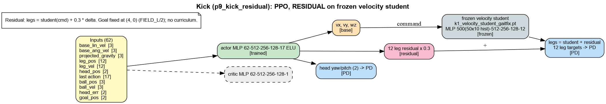

# kick: models, inputs and reward terms

Generated by `isaac_tasks/k1_velocity/scripts/task_docs.py`. Re-run after changing rewards.

Legend: green = trained, grey = frozen, orange = command to a frozen base, pink = residual added to the frozen base's legs, blue = joint targets to PD, purple = arm IK.

## Kick (p9_kick_residual): PPO, RESIDUAL on frozen velocity student

Residual: legs = student(cmd) + 0.3 * delta. Goal fixed at (4, 0) (FIELD_L/2); no curriculum.

### Reward terms

Source: run `p9_kick_residual` params/env.yaml (what the run trained with). Episode 15.0 s, policy dt 0.020 s. Isaac Lab multiplies every weight by dt; `Episode_Reward/<term>` in TensorBoard is the episode sum divided by the episode length in seconds.

| term | weight | function | params | what it computes (docstring) |
|---|---|---|---|---|
| `alive` | 0.5 | `is_alive` (rewards) |  | 1 every step the episode is running. |
| `termination` | -50.0 | `is_terminated` (rewards) |  | 1 on ANY termination except time-out. Penalty. |
| `flat_orientation_l2` | -1.0 | `flat_orientation_l2` (rewards) |  | Squared xy of projected gravity (trunk tilt). Penalty. |
| `action_rate_l2` | -0.01 | `action_rate_l2` (rewards) |  | Squared change of the action between steps. Penalty. |
| `residual_l2` | -0.2 | `residual_l2` (skills_mdp) |  | |residual|^2 actually added to the student's leg output (keeps the skill a residual). |
| `command_rate_l2` | -0.05 | `command_rate_l2` (skills_mdp) |  | |d cmd|^2 between control steps (smooth commands to the student). |
| `head_track` | 1.0 | `track_ball_head_exp` (mdp) | std=0.35 | exp(-(yaw_err^2 + pitch_err^2)/std^2) — head points at the ball (GT, reward-time). |
| `goal_scored` | 50.0 | `goal_scored` (mdp) |  | Binary indicator: ball reached its environment's goal volume. |
| `ball_to_goal_progress` | 1.0 | `ball_to_goal_progress` (mdp) |  | Fraction of this reset's initial ball-to-goal distance closed. |
| `approach_ball` | 1.0 | `approach_ball` (mdp) | min_dist=0.5 | Reward closing the initial robot-to-ball distance while still far away. |
| `kick_toward_goal` | 2.0 | `kick_toward_goal` (mdp) | speed_scale=0.5 | Exponential reward for ball velocity directed toward the goal. |
| `align_stance` | 0.5 | `align_stance` (mdp) | max_dist=0.75 | Reward lining the robot up behind the ball relative to the goal. |
| `face_ball` | 0.3 | `face_ball` (skills_mdp) | std=0.5 | exp(-bearing^2 / std^2): trunk faces the ball (bearing in the root frame). |

### Terminations

| term | function | params | meaning |
|---|---|---|---|
| `time_out` | `time_out` |  | Episode length reached (not a failure). |
| `root_height` | `root_height_below_minimum` | minimum_height=0.35 | Trunk below a fixed height. |
| `base_orientation` | `bad_orientation` | limit_angle=0.8 | Trunk tilt beyond limit_angle (rad). |
| `goal_scored` | `goal_scored` |  | Binary indicator: ball reached its environment's goal volume. |

### Curriculum

None.

---

## Notes (2026-10-11)

- The goal is fixed at `GOAL_POS = (FIELD_L/2, 0, GOAL_H/2)` (`kick/mdp.py`); `curriculum = None`. Ball resets
  come from `reset_ball_omnireset`: at_ball_shoot 50 %, stand_ready 30 %, walk_up 20 %.
- Final run: 3399 iterations, about 53 % goals.
- Proposed: goal-position and ball-distance curriculum (random goal y and distance, widening on success rate).

