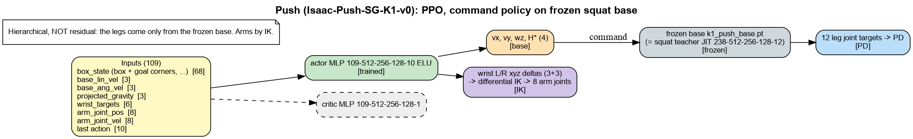
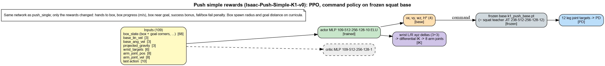
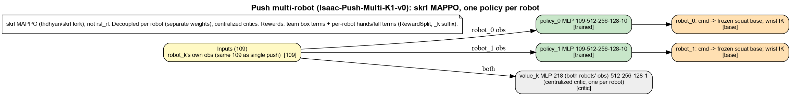

# push: models, inputs and reward terms

Generated by `isaac_tasks/k1_velocity/scripts/task_docs.py`. Re-run after changing rewards.

Legend: green = trained, grey = frozen, orange = command to a frozen base, pink = residual added to the frozen base's legs, blue = joint targets to PD, purple = arm IK.

## Push (Isaac-Push-SG-K1-v0): PPO, command policy on frozen squat base

Hierarchical, NOT residual: the legs come only from the frozen base. Arms by IK.

### Reward terms

Source: run `p6_push` params/env.yaml (what the run trained with). Episode 20.0 s, policy dt 0.020 s. Isaac Lab multiplies every weight by dt; `Episode_Reward/<term>` in TensorBoard is the episode sum divided by the episode length in seconds.

| term | weight | function | params | what it computes (docstring) |
|---|---|---|---|---|
| `wrist_target_tracking` | 0.3 | `wrist_target_tracking` (push_mdp) |  | -max ||wrist_pos_base - commanded target|| over the two wrists (both must track). |
| `wrist_box_proximity` | 0.5 | `wrist_box_proximity` (push_mdp) |  | two-scale exp(-max wrist-to-box gap / scale), summed (0..2). |
| `track_cmd_lin_vel` | 0.25 | `track_cmd_lin_vel_exp` (push_mdp) | std=0.5 |  |
| `track_cmd_ang_vel` | 0.1 | `track_cmd_ang_vel_exp` (push_mdp) | std=0.5 |  |
| `base_height_command` | 1.0 | `base_height_command` (push_mdp) | std=0.05 | exp(-|z - H*| / std): trunk height tracks the CURRENT command. |
| `success_bonus` | 50.0 | `success_bonus` (push_mdp) |  | Sparse +1 exactly once per success. |
| `flat_orientation_l2` | -1.0 | `flat_orientation_l2` (rewards) |  | Squared xy of projected gravity (trunk tilt). Penalty. |
| `action_rate_l2` | -0.005 | `action_rate_l2` (rewards) |  | Squared change of the action between steps. Penalty. |
| `dof_torques_l2` | -1.5e-07 | `joint_torques_l2` (rewards) | asset_cfg=robot[ALeft_Shoulder_Pitch,Left_Shoulder_Roll,Left_Elbow_Pitch,Left_Elbow_Yaw,ARight_Shoulder_Pitch,Right_Shoulder_Roll,Right_Elbow_Pitch,Right_Elbow_Yaw] | Squared joint torques on the selected joints. Penalty. |
| `joint_pos_limits` | -1.0 | `joint_pos_limits` (rewards) | asset_cfg=robot[ALeft_Shoulder_Pitch,Left_Shoulder_Roll,Left_Elbow_Pitch,Left_Elbow_Yaw,ARight_Shoulder_Pitch,Right_Shoulder_Roll,Right_Elbow_Pitch,Right_Elbow_Yaw] | Joint positions beyond soft limits. Penalty. |
| `termination_penalty` | -200.0 | `failure_terminated` (push_mdp) |  | 1.0 on non-timeout terminations EXCLUDING goal_reached: the -200 penalty must not charge success (fix A9/A10 - vmdp.is_terminated only excluded time_out; adding a success term would have made success net -150). Per-term dones are refreshed by the termination manager before rewards, so this reads the current step. |
| `approach_object` | 2.0 | `approach_object_recip` (push_rewards_sg) |  | Arm-contact approach: reciprocal gap from the wrists to the box face. |
| `fast_approach` | 1.5 | `fast_approach` (push_rewards_sg) | contact_dist=0.6 | Reward closing the wrist->box gap, but only while still out of contact. |
| `task_box_goal` | 1.5 | `task_box_to_goal_recip` (push_rewards_sg) |  | Reciprocal box-centre to fixed-goal distance (the task objective proper). |
| `heading_progress` | 0.6 | `heading_progress_combo` (push_rewards_sg) | contact_dist=0.7 | Heading alignment with the goal, gated to only count while in contact. |
| `stop_bonus` | 5.0 | `stop_at_goal_box_still` (push_rewards_sg) |  | Bonus for the box being inside the goal AND stationary. |
| `etiquette` | 1.0 | `push_pull_etiquette` (push_rewards_sg) |  | Penalise dragging the box backwards; reward keeping the wrists off it. |
| `parked` | 0.3 | `parked_bonus` (push_rewards_sg) |  | Dense reward for the actual success event, plus arm withdrawal. |

### Terminations

| term | function | params | meaning |
|---|---|---|---|
| `time_out` | `time_out` |  | Episode length reached (not a failure). |
| `height_below_command` | `height_below_command` | margin=0.05 | Trunk below H* - margin = failure (fix A12: v2's fixed 0.35 floor is meaningless once the policy commands squats at 0.40-0.55). Flat ground -> world z equals terrain-relative z. |
| `bad_orientation` | `bad_orientation` | limit_angle=0.8 | Trunk tilt beyond limit_angle (rad). |
| `goal_reached` | `goal_reached` | err_thresh=0.08, hold_s=1.0 | Success: mean corner error < err_thresh held for hold_s seconds. |
| `box_oob` | `box_out_of_bounds` | radius=1.9 | Box centre beyond `radius` from the env origin = failure (fix A11: v2 parked the box anywhere - no bounds term, no failure count). radius > GOAL_WORKSPACE_R keeps every legal goal inside bounds, with 0.4 m of overshoot margin before the failure fires. |
| `box_tip` | `box_tipped` | limit_deg=45.0 | Box roll/pitch past limit_deg = failure (fix A13: v2 only had a spin penalty - a tipped box made the corner goal unreachable but the episode kept running). Box up-axis z < cos(limit) -> tipped. |

### Curriculum

- `goal_dist`: `goal_dist_curriculum` start_iter=200, end_iter=1800, d_max=1.5. Goal distance cap 0.3 -> d_max metres (iterations via physics steps).
- `goal_yaw`: `goal_yaw_curriculum` start_iter=1800, end_iter=3000, yaw0_deg=30.0, yaw_max_deg=180.0. Phase 2 of the goal curriculum (A3): goal yaw delta +-30 -> +-180 deg, phased AFTER the distance walk (start_iter = its end) so orientation tracking enters only once distance pushing works. The goal's own yaw is what makes box rotation task-relevant (v2's spin penalty punished ALL rotation while goal yaw was pinned to box yaw - no orientation task).

## Push simple rewards (Isaac-Push-Simple-K1-v0): PPO, command policy on frozen squat base

Same network as push_single; only the rewards changed: hands to box, box progress (m/s), box near goal, success bonus, fall/box-fail penalty. Box spawn radius and goal distance on curricula.

### Reward terms

Source: run `p6_push_simple` params/env.yaml (what the run trained with). Episode 20.0 s, policy dt 0.020 s. Isaac Lab multiplies every weight by dt; `Episode_Reward/<term>` in TensorBoard is the episode sum divided by the episode length in seconds.

| term | weight | function | params | what it computes (docstring) |
|---|---|---|---|---|
| `hands_to_box` | 0.5 | `wrist_box_proximity` (push_mdp) |  | two-scale exp(-max wrist-to-box gap / scale), summed (0..2). |
| `box_progress` | 5.0 | `box_goal_progress_rate` (push_mdp) |  | box_goal_progress per SECOND (metres of centroid error closed / s). |
| `box_near_goal` | 2.0 | `box_goal_near` (push_mdp) | std=0.5 | exp(-|box centre - goal centre|_xy / std): dense pull that peaks at the goal. |
| `success_bonus` | 500.0 | `success_bonus` (push_mdp) |  | Sparse +1 exactly once per success. |
| `termination_penalty` | -500.0 | `term_fired` (push_mdp) | term_names=['fallen', 'box_oob', 'box_tip'] | 1.0 where any of the named termination terms fired this step. |
| `flat_orientation_l2` | -1.0 | `flat_orientation_l2` (rewards) |  | Squared xy of projected gravity (trunk tilt). Penalty. |
| `action_rate_l2` | -0.005 | `action_rate_l2` (rewards) |  | Squared change of the action between steps. Penalty. |
| `joint_pos_limits` | -1.0 | `joint_pos_limits` (rewards) | asset_cfg=robot[ALeft_Shoulder_Pitch,Left_Shoulder_Roll,Left_Elbow_Pitch,Left_Elbow_Yaw,ARight_Shoulder_Pitch,Right_Shoulder_Roll,Right_Elbow_Pitch,Right_Elbow_Yaw] | Joint positions beyond soft limits. Penalty. |

### Terminations

| term | function | params | meaning |
|---|---|---|---|
| `time_out` | `time_out` |  | Episode length reached (not a failure). |
| `fallen` | `robot_fallen` | min_z=0.3, limit_angle=0.8 | Real fall only: trunk below min_z or tilted past limit_angle (rad). |
| `goal_reached` | `goal_reached_centroid` | err_thresh=0.15, hold_s=1.0 | Success on box POSITION only: centre within err_thresh of the goal for hold_s. |
| `box_oob` | `box_out_of_bounds` | radius=3.0 | Box centre beyond `radius` from the env origin = failure (fix A11: v2 parked the box anywhere - no bounds term, no failure count). radius > GOAL_WORKSPACE_R keeps every legal goal inside bounds, with 0.4 m of overshoot margin before the failure fires. |
| `box_tip` | `box_tipped` | limit_deg=45.0 | Box roll/pitch past limit_deg = failure (fix A13: v2 only had a spin penalty - a tipped box made the corner goal unreachable but the episode kept running). Box up-axis z < cos(limit) -> tipped. |

### Curriculum

- `box_dist`: `box_dist_curriculum` start_iter=200, end_iter=1800, r0=[0.75, 0.9], r1=[0.9, 1.8]. Robot->box spawn radius range r0 -> r1 (linear in iterations, like goal_dist).
- `goal_dist`: `goal_dist_curriculum` start_iter=200, end_iter=1800, d_max=2.5. Goal distance cap 0.3 -> d_max metres (iterations via physics steps).

## Push multi-robot (Isaac-Push-Multi-K1-v0): skrl MAPPO, one policy per robot

skrl MAPPO (thdhyan/skrl fork), not rsl_rl. Decoupled per robot (separate weights), centralized critics. Rewards: team box terms + per-robot hands/fall terms (RewardSplit, _k suffix).

---

## Why the push robot stands still: reward hacking audit (2026-10-11)

Run `p6_push/2026-10-10_18-59-36` (SG reward set, 5000 iterations). `goal_reached` was 0 % for the whole run.
How to read the numbers: `Episode_Reward/x` is about `weight * mean(func)` per second, so it is directly comparable
between terms.

| term | it200 | it4999 | can it be earned without moving the box? |
|---|---|---|---|
| fast_approach | 0.29 | **1.13** | **yes, it can be farmed** (see 2) |
| etiquette | 0.76 | **0.85** | **yes**: +1 per step for keeping the wrists > 0.5 m from the box (see 1) |
| base_height_command | 0.64 | 0.75 | yes (holding H*) |
| approach_object | 0.47 | 0.53 | yes (hovering near the box) |
| task_box_goal | 0.68 | 0.40 | yes (baseline 0.35/(0.35+d) paid with the box untouched) |
| heading_progress | 0.19 | 0.33 | **yes, sign bug**: pays only while NOT in contact (see 3) |
| stop_bonus | **4.18** | 0.21 | **yes at the start of training** (see 4) |
| track_cmd_lin_vel | 0.15 | 0.12 | yes (command 0, stand) |
| success_bonus / parked | 0 | 0 | never reached |

Only one term pays for the box actually moving toward the goal: the `along / 0.10` part of `etiquette`. Moving
the box needs the wrists on the box, which zeroes the +1 standoff part of the same term and risks a −4 fall
(−200 × dt). So pushing is worth about zero net, and standing near the box is the optimum.

1. **`push_pull_etiquette` pays standoff the whole episode.** `standoff = gap.mean > 0.5` m adds +1 every step,
   which rewards *not touching* the box. It was meant for "withdraw after parking", but it is not gated on success.
   Fix: drop the standoff part, or multiply it by the `goal_reached` hold state.
2. **`fast_approach` can be farmed.** It is `clamp(prev_gap - gap, min=0) / dt` while gap > 0.6 m. Moving the
   arms/body in and out pays on every inward stroke and costs nothing on the outward one. 1.13/1.5 means a mean
   closing speed of 0.75 m/s, far more than a real approach. Fix: make it potential-based and signed,
   `(prev_gap - gap) / dt` without the clamp, which telescopes to a constant over the episode, or delete it
   (`approach_object` already shapes the approach).
3. **`heading_progress_combo` gate is inverted.** `engagement(gap, d) = gap > d` is 1 when FAR from the box, but
   the docstring says "only count while in contact". It pays for facing the goal from a distance. Fix: gate on
   `gap <= contact_dist`.
4. **`stop_at_goal_box_still` pays at reset.** Curriculum `goal_dist` starts at 0.30 m, but the stop radius is
   0.35 m. So the box starts inside the goal and still, and the policy got +5 per step for standing (it200: 4.18 of
   about 137 total). That locked in "do not touch the box" before the curriculum moved the goal out.
   Fix: curriculum start > 0.35 m (e.g. 0.5), or pay only after the box has entered the goal from outside.
5. **No dense progress term.** `box_goal_progress` and `box_vel_toward_goal` (v3, potential-based) are retired in
   the SG set. Fix: re-enable `box_goal_progress` (w 2.0) and `box_vel_toward_goal` (w 0.5).
6. **Success is too hard.** Mean CORNER error < 0.08 m, held for 1 s, with the goal yaw curriculum reaching ±180°,
   means rotating the box while pushing. Fix: centroid-only success first, or turn yaw on only after
   success > 20 %.

Not changed yet: these need a decision and a fresh push run.

Also: the play/eval env (`K1PushSGPlayEnvCfg`) sets `curriculum = None`, so videos always show the 0.30 m start
goal (inside the stop radius). Play should use the final curriculum values.

