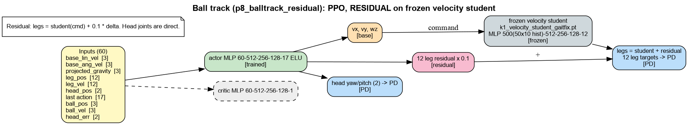

# skills: models, inputs and reward terms

Generated by `isaac_tasks/k1_velocity/scripts/task_docs.py`. Re-run after changing rewards.

Legend: green = trained, grey = frozen, orange = command to a frozen base, pink = residual added to the frozen base's legs, blue = joint targets to PD, purple = arm IK.

## Ball track (p8_balltrack_residual): PPO, RESIDUAL on frozen velocity student

Residual: legs = student(cmd) + 0.1 * delta. Head joints are direct.

### Reward terms

Source: run `p8_balltrack_residual` params/env.yaml (what the run trained with). Episode 20.0 s, policy dt 0.020 s. Isaac Lab multiplies every weight by dt; `Episode_Reward/<term>` in TensorBoard is the episode sum divided by the episode length in seconds.

| term | weight | function | params | what it computes (docstring) |
|---|---|---|---|---|
| `alive` | 0.5 | `is_alive` (rewards) |  | 1 every step the episode is running. |
| `termination` | -50.0 | `is_terminated` (rewards) |  | 1 on ANY termination except time-out. Penalty. |
| `flat_orientation_l2` | -1.0 | `flat_orientation_l2` (rewards) |  | Squared xy of projected gravity (trunk tilt). Penalty. |
| `action_rate_l2` | -0.01 | `action_rate_l2` (rewards) |  | Squared change of the action between steps. Penalty. |
| `residual_l2` | -0.5 | `residual_l2` (skills_mdp) |  | |residual|^2 actually added to the student's leg output (keeps the skill a residual). |
| `command_rate_l2` | -0.05 | `command_rate_l2` (skills_mdp) |  | |d cmd|^2 between control steps (smooth commands to the student). |
| `head_track` | 1.0 | `track_ball_head_exp` (mdp) | std=0.35 | exp(-(yaw_err^2 + pitch_err^2)/std^2) — head points at the ball (GT, reward-time). |
| `ball_distance` | 1.5 | `ball_distance_keep` (skills_mdp) | target=0.8, std=0.4 | exp(-(d_xy - target)^2 / std^2): stay at the tracking distance from the ball. |
| `face_ball` | 0.5 | `face_ball` (skills_mdp) | std=0.5 | exp(-bearing^2 / std^2): trunk faces the ball (bearing in the root frame). |
| `ball_visible` | 0.5 | `ball_visible` (skills_mdp) |  | 1 while the ball is inside the head camera FOV (geometric proxy). |

### Terminations

| term | function | params | meaning |
|---|---|---|---|
| `time_out` | `time_out` |  | Episode length reached (not a failure). |
| `root_height` | `root_height_below_minimum` | minimum_height=0.35 | Trunk below a fixed height. |
| `base_orientation` | `bad_orientation` | limit_angle=0.8 | Trunk tilt beyond limit_angle (rad). |
| `ball_lost` | `ball_lost` | max_dist=3.5 | Ball further than max_dist from the robot = lost track (termination). |

### Curriculum

- `ball_speed`: `ball_speed_curriculum` . 0 -> v_max roll speed over [start_step, end_step] control steps.

