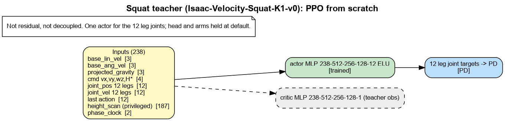
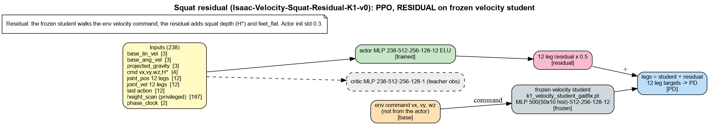
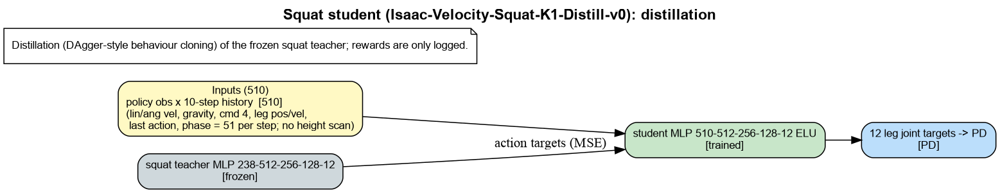
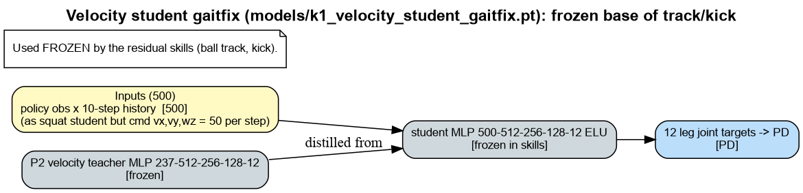

# velocity: models, inputs and reward terms

Generated by `isaac_tasks/k1_velocity/scripts/task_docs.py`. Re-run after changing rewards.

Legend: green = trained, grey = frozen, orange = command to a frozen base, pink = residual added to the frozen base's legs, blue = joint targets to PD, purple = arm IK.

## Squat teacher (Isaac-Velocity-Squat-K1-v0): PPO from scratch

Not residual, not decoupled. One actor for the 12 leg joints; head and arms held at default.

### Reward terms

Source: run `k1_squat_teacher` params/env.yaml (what the run trained with). Episode 20.0 s, policy dt 0.020 s. Isaac Lab multiplies every weight by dt; `Episode_Reward/<term>` in TensorBoard is the episode sum divided by the episode length in seconds.

| term | weight | function | params | what it computes (docstring) |
|---|---|---|---|---|
| `track_lin_vel_xy_exp` | 10.0 | `track_lin_vel_xy_exp_weighted` (agile_rewards) | command_name=base_velocity, std=0.15 | AGILE ``track_lin_vel_xy_yaw_frame_exp_weighted_simplified``. |
| `track_ang_vel_z_exp` | 5.0 | `track_ang_vel_z_world_exp_weighted` (agile_rewards) | command_name=base_velocity, std=0.25 | AGILE ``track_ang_vel_z_world_exp_weighted_simplified``. |
| `base_height` | 2.0 | `base_height_cmd_exp` (squat_mdp) | command_name=base_velocity, std=0.05, sensor_name=height_scanner | Per-env exponential kernel on ``|terrain-relative trunk height - H*|``. |
| `flat_orientation_l2` | -5.0 | `flat_orientation_l2` (rewards) | asset_cfg=robot[Trunk] | Squared xy of projected gravity (trunk tilt). Penalty. |
| `termination_penalty` | -200.0 | `is_terminated` (rewards) |  | 1 on ANY termination except time-out. Penalty. |
| `feet_slide` | -0.25 | `feet_slide` (rewards) | sensor_cfg=contact_forces[left_foot_link,right_foot_link], asset_cfg=robot[left_foot_link,right_foot_link] | Foot xy speed while the foot is in contact. Penalty. |
| `feet_roll` | -0.1 | `feet_roll_l2` (gait_rewards) | asset_cfg=robot[left_foot_link,right_foot_link] | Squared foot roll -- keeps the sole flat instead of toe-walking (AGILE ``feet_roll``). |
| `feet_yaw_diff` | -0.2 | `feet_yaw_diff_l2` (gait_rewards) | asset_cfg=robot[left_foot_link,right_foot_link] | Squared difference between the two feet's world yaw (AGILE ``feet_yaw_diff``). |
| `feet_yaw_mean` | -4.0 | `feet_yaw_mean_vs_base` (gait_rewards) | feet_asset_cfg=robot[left_foot_link,right_foot_link], base_body_cfg=robot[Trunk] | Penalise feet that drift out of the base's heading (AGILE ``feet_yaw_mean``). |
| `feet_distance` | -0.2 | `feet_distance_from_ref` (gait_rewards) | ref_distance=0.2, asset_cfg=robot[left_foot_link,right_foot_link] | Squared error of the two feet's horizontal separation from ``ref_distance``. |
| `ankle_torques` | -0.0001 | `joint_torques_l2` (rewards) | asset_cfg=robot[(?i).*_Ankle_.*] | Squared joint torques on the selected joints. Penalty. |
| `dof_vel` | -0.0002 | `joint_vel_l2` (rewards) | asset_cfg=robot | Squared joint velocities. Penalty. |
| `jumping` | -0.5 | `jumping` (agile_rewards) | threshold=1.0, sensor_cfg=contact_forces[left_foot_link,right_foot_link] | AGILE ``jumping`` -- penalise both feet leaving the ground at once. |
| `lin_vel_z_l2` | -0.5 | `lin_vel_z_l2` (rewards) |  | Squared vertical trunk velocity. Penalty. |
| `ang_vel_xy_l2` | -0.5 | `ang_vel_xy_l2` (rewards) |  | Squared roll/pitch rate of the trunk. Penalty. |
| `action_rate_l2` | -0.1 | `action_rate_l2` (rewards) |  | Squared change of the action between steps. Penalty. |
| `action_jerk_l2` | -0.01 | `action_jerk_l2` (gait_rewards) | asset_cfg=robot[Left_Hip_Pitch,Left_Hip_Roll,Left_Hip_Yaw,Left_Knee_Pitch,Left_Ankle_Pitch,Left_Ankle_Roll,Right_Hip_Pitch,Right_Hip_Roll,Right_Hip_Yaw,Right_Knee_Pitch,Right_Ankle_Pitch,Right_Ankle_Roll] | Squared third difference of the joint targets -- an explicit jerk penalty. |
| `dof_acc_l2` | -2.5e-07 | `joint_acc_l2` (rewards) | asset_cfg=robot[Left_Hip_Pitch,Left_Hip_Roll,Left_Hip_Yaw,Left_Knee_Pitch,Left_Ankle_Pitch,Left_Ankle_Roll,Right_Hip_Pitch,Right_Hip_Roll,Right_Hip_Yaw,Right_Knee_Pitch,Right_Ankle_Pitch,Right_Ankle_Roll] | Squared joint accelerations. Penalty. |
| `dof_torques_l2` | -0.0001 | `joint_torques_l2` (rewards) | asset_cfg=robot[Left_Hip_Pitch,Left_Hip_Roll,Left_Hip_Yaw,Left_Knee_Pitch,Left_Ankle_Pitch,Left_Ankle_Roll,Right_Hip_Pitch,Right_Hip_Roll,Right_Hip_Yaw,Right_Knee_Pitch,Right_Ankle_Pitch,Right_Ankle_Roll] | Squared joint torques on the selected joints. Penalty. |
| `ankle_roll_torques` | -0.002 | `joint_torques_l2` (rewards) | asset_cfg=robot[.*_Ankle_Roll] | Squared joint torques on the selected joints. Penalty. |
| `dof_pos_limits` | -1.0 | `joint_pos_limits` (rewards) | asset_cfg=robot[Left_Hip_Pitch,Left_Hip_Roll,Left_Hip_Yaw,Left_Knee_Pitch,Left_Ankle_Pitch,Left_Ankle_Roll,Right_Hip_Pitch,Right_Hip_Roll,Right_Hip_Yaw,Right_Knee_Pitch,Right_Ankle_Pitch,Right_Ankle_Roll] | Joint positions beyond soft limits. Penalty. |
| `dof_vel_limits` | -1.0 | `joint_vel_limits` (rewards) | soft_ratio=0.9, asset_cfg=robot[Left_Hip_Pitch,Left_Hip_Roll,Left_Hip_Yaw,Left_Knee_Pitch,Left_Ankle_Pitch,Left_Ankle_Roll,Right_Hip_Pitch,Right_Hip_Roll,Right_Hip_Yaw,Right_Knee_Pitch,Right_Ankle_Pitch,Right_Ankle_Roll] | Joint velocities beyond soft limits. Penalty. |
| `torque_limits` | -0.01 | `applied_torque_limits` (rewards) | asset_cfg=robot[Left_Hip_Pitch,Left_Hip_Roll,Left_Hip_Yaw,Left_Knee_Pitch,Left_Ankle_Pitch,Left_Ankle_Roll,Right_Hip_Pitch,Right_Hip_Roll,Right_Hip_Yaw,Right_Knee_Pitch,Right_Ankle_Pitch,Right_Ankle_Roll] | Gap between computed and applied (clipped) torque. Penalty. |
| `body_acc_l2` | -2e-05 | `body_lin_acc_l2` (rewards) | asset_cfg=robot | Squared linear acceleration of the selected bodies. Penalty. |
| `joint_deviation_arms` | -0.1 | `joint_deviation_l1` (rewards) | asset_cfg=robot[AAHead_yaw,Head_pitch,ALeft_Shoulder_Pitch,Left_Shoulder_Roll,Left_Elbow_Pitch,Left_Elbow_Yaw,ARight_Shoulder_Pitch,Right_Shoulder_Roll,Right_Elbow_Pitch,Right_Elbow_Yaw] | Isaac Lab built-in. |
| `gait_cadence` | -0.2 | `gait_cadence_penalty` (gait_rewards) | target_hz=2.0, dt=0.02, asset_cfg=robot[Left_Hip_Pitch,Left_Hip_Roll,Left_Hip_Yaw,Left_Knee_Pitch,Left_Ankle_Pitch,Left_Ankle_Roll,Right_Hip_Pitch,Right_Hip_Roll,Right_Hip_Yaw,Right_Knee_Pitch,Right_Ankle_Pitch,Right_Ankle_Roll] | Penalise step frequency far from ``target_hz``. |
| `phase_locked_stride` | -4.0 | `phase_locked_stride` (gait_rewards) | target_stride=0.22, asset_cfg=robot[left_foot_link,right_foot_link], base_body_cfg=robot[Trunk] | Penalise fore-aft foot placement that disagrees with the gait clock. |
| `phase_swing` | -0.4 | `phase_synced_swing` (gait_rewards) | contact_cfg=contact_forces[left_foot_link,right_foot_link] | Penalise each foot being grounded during its swing window and vice versa. |
| `feet_clearance` | -1.6 | `feet_clearance` (gait_rewards) | target_lift=0.06, contact_cfg=contact_forces[left_foot_link,right_foot_link], asset_cfg=robot[left_foot_link,right_foot_link] | Penalise a swing foot that is not lifted clear of the stance foot. |
| `feet_alternation` | -0.4 | `feet_alternation_penalty` (gait_rewards) | contact_cfg=contact_forces[left_foot_link,right_foot_link] | Penalise both feet being in contact at the same time for long stretches. |
| `stride_length` | -1.2 | `stride_length_penalty` (gait_rewards) | target_stride=0.22, asset_cfg=robot[left_foot_link,right_foot_link] | Penalise fore-aft foot separation far below ``target_stride``. |
| `undesired_contacts` | -1.0 | `undesired_contacts` (rewards) | threshold=1.0, sensor_cfg=contact_forces[Trunk,.*_Hip_Pitch,.*_Hip_Roll,.*_Hip_Yaw] | Count of bodies (not feet) touching the ground over a force threshold. Penalty. |

### Terminations

| term | function | params | meaning |
|---|---|---|---|
| `time_out` | `time_out` |  | Episode length reached (not a failure). |
| `root_height` | `root_height_below_commanded_floor` | command_name=base_velocity, margin=0.05, minimum_height=0.35, sensor_name=height_scanner | Terminate when the trunk sinks below its commanded floor. |
| `base_orientation` | `bad_orientation` | limit_angle=0.5235987755982988 | Trunk tilt beyond limit_angle (rad). |
| `illegal_contact` | `illegal_contact` | threshold=20.0, sensor_cfg=contact_forces[Trunk] | Selected bodies touch the ground. |

### Curriculum

- `terrain_levels`: `terrain_levels_vel` asset_cfg=robot. Move envs up/down the terrain grid by distance walked.
- `squat_depth`: `squat_depth_curriculum` command_name=base_velocity, steps_per_iter=24, stage_iters=[500, 1100, 1900, 2700, 3500], stage_rel_squat=[0.1, 0.25, 0.25, 0.25, 0.25], stage_height_range=[[0.5, 0.55], [0.5, 0.55], [0.46, 0.53], [0.42, 0.5], [0.4, 0.48]], stage_gates=['vel', 'height', 'height', 'height', 'height'], height_gate=0.025, vel_gate=0.3. Step the squat fraction/depth forward, gated on the command term's EMAs.

## Squat residual (Isaac-Velocity-Squat-Residual-K1-v0): PPO, RESIDUAL on frozen velocity student

Residual: the frozen student walks the env velocity command; the residual adds squat depth (H*) and feet_flat. Actor init std 0.3.

### Reward terms

Source: run `k1_squat_residual` params/env.yaml (what the run trained with). Episode 20.0 s, policy dt 0.020 s. Isaac Lab multiplies every weight by dt; `Episode_Reward/<term>` in TensorBoard is the episode sum divided by the episode length in seconds.

| term | weight | function | params | what it computes (docstring) |
|---|---|---|---|---|
| `track_lin_vel_xy_exp` | 10.0 | `track_lin_vel_xy_exp_weighted` (agile_rewards) | command_name=base_velocity, std=0.15 | AGILE ``track_lin_vel_xy_yaw_frame_exp_weighted_simplified``. |
| `track_ang_vel_z_exp` | 5.0 | `track_ang_vel_z_world_exp_weighted` (agile_rewards) | command_name=base_velocity, std=0.25 | AGILE ``track_ang_vel_z_world_exp_weighted_simplified``. |
| `base_height` | 2.0 | `base_height_cmd_exp` (squat_mdp) | command_name=base_velocity, std=0.05, sensor_name=height_scanner | Per-env exponential kernel on ``|terrain-relative trunk height - H*|``. |
| `flat_orientation_l2` | -5.0 | `flat_orientation_l2` (rewards) | asset_cfg=robot[Trunk] | Squared xy of projected gravity (trunk tilt). Penalty. |
| `termination_penalty` | -200.0 | `is_terminated` (rewards) |  | 1 on ANY termination except time-out. Penalty. |
| `feet_slide` | -0.25 | `feet_slide` (rewards) | sensor_cfg=contact_forces[left_foot_link,right_foot_link], asset_cfg=robot[left_foot_link,right_foot_link] | Foot xy speed while the foot is in contact. Penalty. |
| `feet_roll` | -0.1 | `feet_roll_l2` (gait_rewards) | asset_cfg=robot[left_foot_link,right_foot_link] | Squared foot roll -- keeps the sole flat instead of toe-walking (AGILE ``feet_roll``). |
| `feet_yaw_diff` | -0.2 | `feet_yaw_diff_l2` (gait_rewards) | asset_cfg=robot[left_foot_link,right_foot_link] | Squared difference between the two feet's world yaw (AGILE ``feet_yaw_diff``). |
| `feet_yaw_mean` | -4.0 | `feet_yaw_mean_vs_base` (gait_rewards) | feet_asset_cfg=robot[left_foot_link,right_foot_link], base_body_cfg=robot[Trunk] | Penalise feet that drift out of the base's heading (AGILE ``feet_yaw_mean``). |
| `feet_distance` | -0.2 | `feet_distance_from_ref` (gait_rewards) | ref_distance=0.2, asset_cfg=robot[left_foot_link,right_foot_link] | Squared error of the two feet's horizontal separation from ``ref_distance``. |
| `ankle_torques` | -0.0001 | `joint_torques_l2` (rewards) | asset_cfg=robot[(?i).*_Ankle_.*] | Squared joint torques on the selected joints. Penalty. |
| `dof_vel` | -0.0002 | `joint_vel_l2` (rewards) | asset_cfg=robot | Squared joint velocities. Penalty. |
| `jumping` | -0.5 | `jumping` (agile_rewards) | threshold=1.0, sensor_cfg=contact_forces[left_foot_link,right_foot_link] | AGILE ``jumping`` -- penalise both feet leaving the ground at once. |
| `lin_vel_z_l2` | -0.5 | `lin_vel_z_l2` (rewards) |  | Squared vertical trunk velocity. Penalty. |
| `ang_vel_xy_l2` | -0.5 | `ang_vel_xy_l2` (rewards) |  | Squared roll/pitch rate of the trunk. Penalty. |
| `action_rate_l2` | -0.1 | `action_rate_l2` (rewards) |  | Squared change of the action between steps. Penalty. |
| `action_jerk_l2` | -0.01 | `action_jerk_l2` (gait_rewards) | asset_cfg=robot[Left_Hip_Pitch,Left_Hip_Roll,Left_Hip_Yaw,Left_Knee_Pitch,Left_Ankle_Pitch,Left_Ankle_Roll,Right_Hip_Pitch,Right_Hip_Roll,Right_Hip_Yaw,Right_Knee_Pitch,Right_Ankle_Pitch,Right_Ankle_Roll] | Squared third difference of the joint targets -- an explicit jerk penalty. |
| `dof_acc_l2` | -2.5e-07 | `joint_acc_l2` (rewards) | asset_cfg=robot[Left_Hip_Pitch,Left_Hip_Roll,Left_Hip_Yaw,Left_Knee_Pitch,Left_Ankle_Pitch,Left_Ankle_Roll,Right_Hip_Pitch,Right_Hip_Roll,Right_Hip_Yaw,Right_Knee_Pitch,Right_Ankle_Pitch,Right_Ankle_Roll] | Squared joint accelerations. Penalty. |
| `dof_torques_l2` | -0.0001 | `joint_torques_l2` (rewards) | asset_cfg=robot[Left_Hip_Pitch,Left_Hip_Roll,Left_Hip_Yaw,Left_Knee_Pitch,Left_Ankle_Pitch,Left_Ankle_Roll,Right_Hip_Pitch,Right_Hip_Roll,Right_Hip_Yaw,Right_Knee_Pitch,Right_Ankle_Pitch,Right_Ankle_Roll] | Squared joint torques on the selected joints. Penalty. |
| `ankle_roll_torques` | -0.002 | `joint_torques_l2` (rewards) | asset_cfg=robot[.*_Ankle_Roll] | Squared joint torques on the selected joints. Penalty. |
| `dof_pos_limits` | -1.0 | `joint_pos_limits` (rewards) | asset_cfg=robot[Left_Hip_Pitch,Left_Hip_Roll,Left_Hip_Yaw,Left_Knee_Pitch,Left_Ankle_Pitch,Left_Ankle_Roll,Right_Hip_Pitch,Right_Hip_Roll,Right_Hip_Yaw,Right_Knee_Pitch,Right_Ankle_Pitch,Right_Ankle_Roll] | Joint positions beyond soft limits. Penalty. |
| `dof_vel_limits` | -1.0 | `joint_vel_limits` (rewards) | soft_ratio=0.9, asset_cfg=robot[Left_Hip_Pitch,Left_Hip_Roll,Left_Hip_Yaw,Left_Knee_Pitch,Left_Ankle_Pitch,Left_Ankle_Roll,Right_Hip_Pitch,Right_Hip_Roll,Right_Hip_Yaw,Right_Knee_Pitch,Right_Ankle_Pitch,Right_Ankle_Roll] | Joint velocities beyond soft limits. Penalty. |
| `torque_limits` | -0.01 | `applied_torque_limits` (rewards) | asset_cfg=robot[Left_Hip_Pitch,Left_Hip_Roll,Left_Hip_Yaw,Left_Knee_Pitch,Left_Ankle_Pitch,Left_Ankle_Roll,Right_Hip_Pitch,Right_Hip_Roll,Right_Hip_Yaw,Right_Knee_Pitch,Right_Ankle_Pitch,Right_Ankle_Roll] | Gap between computed and applied (clipped) torque. Penalty. |
| `body_acc_l2` | -2e-05 | `body_lin_acc_l2` (rewards) | asset_cfg=robot | Squared linear acceleration of the selected bodies. Penalty. |
| `joint_deviation_arms` | -0.1 | `joint_deviation_l1` (rewards) | asset_cfg=robot[AAHead_yaw,Head_pitch,ALeft_Shoulder_Pitch,Left_Shoulder_Roll,Left_Elbow_Pitch,Left_Elbow_Yaw,ARight_Shoulder_Pitch,Right_Shoulder_Roll,Right_Elbow_Pitch,Right_Elbow_Yaw] | Isaac Lab built-in. |
| `gait_cadence` | -0.2 | `gait_cadence_penalty` (gait_rewards) | target_hz=2.0, dt=0.02, asset_cfg=robot[Left_Hip_Pitch,Left_Hip_Roll,Left_Hip_Yaw,Left_Knee_Pitch,Left_Ankle_Pitch,Left_Ankle_Roll,Right_Hip_Pitch,Right_Hip_Roll,Right_Hip_Yaw,Right_Knee_Pitch,Right_Ankle_Pitch,Right_Ankle_Roll] | Penalise step frequency far from ``target_hz``. |
| `phase_locked_stride` | -4.0 | `phase_locked_stride` (gait_rewards) | target_stride=0.22, asset_cfg=robot[left_foot_link,right_foot_link], base_body_cfg=robot[Trunk] | Penalise fore-aft foot placement that disagrees with the gait clock. |
| `phase_swing` | -0.4 | `phase_synced_swing` (gait_rewards) | contact_cfg=contact_forces[left_foot_link,right_foot_link] | Penalise each foot being grounded during its swing window and vice versa. |
| `feet_clearance` | -1.6 | `feet_clearance` (gait_rewards) | target_lift=0.06, contact_cfg=contact_forces[left_foot_link,right_foot_link], asset_cfg=robot[left_foot_link,right_foot_link] | Penalise a swing foot that is not lifted clear of the stance foot. |
| `feet_alternation` | -0.4 | `feet_alternation_penalty` (gait_rewards) | contact_cfg=contact_forces[left_foot_link,right_foot_link] | Penalise both feet being in contact at the same time for long stretches. |
| `stride_length` | -1.2 | `stride_length_penalty` (gait_rewards) | target_stride=0.22, asset_cfg=robot[left_foot_link,right_foot_link] | Penalise fore-aft foot separation far below ``target_stride``. |
| `undesired_contacts` | -1.0 | `undesired_contacts` (rewards) | threshold=1.0, sensor_cfg=contact_forces[Trunk,.*_Hip_Pitch,.*_Hip_Roll,.*_Hip_Yaw] | Count of bodies (not feet) touching the ground over a force threshold. Penalty. |
| `feet_flat` | 1.0 | `feet_flat_contact` (gait_rewards) | std=0.15, sensor_cfg=contact_forces[left_foot_link,right_foot_link], asset_cfg=robot[left_foot_link,right_foot_link] | Reward (>= 0, max 1) for loaded feet whose sole is flat on the ground. |

### Terminations

| term | function | params | meaning |
|---|---|---|---|
| `time_out` | `time_out` |  | Episode length reached (not a failure). |
| `root_height` | `root_height_below_commanded_floor` | command_name=base_velocity, margin=0.05, minimum_height=0.35, sensor_name=height_scanner | Terminate when the trunk sinks below its commanded floor. |
| `base_orientation` | `bad_orientation` | limit_angle=0.5235987755982988 | Trunk tilt beyond limit_angle (rad). |
| `illegal_contact` | `illegal_contact` | threshold=20.0, sensor_cfg=contact_forces[Trunk] | Selected bodies touch the ground. |

### Curriculum

- `terrain_levels`: `terrain_levels_vel` asset_cfg=robot. Move envs up/down the terrain grid by distance walked.
- `squat_depth`: `squat_depth_curriculum` command_name=base_velocity, steps_per_iter=24, stage_iters=[500, 1100, 1900, 2700, 3500], stage_rel_squat=[0.1, 0.25, 0.25, 0.25, 0.25], stage_height_range=[[0.5, 0.55], [0.5, 0.55], [0.46, 0.53], [0.42, 0.5], [0.4, 0.48]], stage_gates=['vel', 'height', 'height', 'height', 'height'], height_gate=0.025, vel_gate=0.3. Step the squat fraction/depth forward, gated on the command term's EMAs.

## Squat student (Isaac-Velocity-Squat-K1-Distill-v0): distillation

Distillation (DAgger-style behaviour cloning) of the frozen squat teacher; rewards are only logged.

## Velocity student gaitfix (models/k1_velocity_student_gaitfix.pt): frozen base of track/kick

Used FROZEN by the residual skills (ball track, kick).

---

## Notes (2026-10-11)

- **New since the run above:** `feet_flat` (`gait_rewards.feet_flat_contact`, weight +1.0, std 0.15) in
  `SquatRewardsCfg`. It pays per loaded foot (contact force > 5 N) for a level sole,
  `exp(-|g_xy in foot frame|^2 / 0.15^2)`: 6° tilt keeps 61 % of the credit, 15° keeps 5 %. The old `feet_roll`
  only charged roll, so heel/toe pitch ("standing on the ankles") was free. The squat students inherit the env, so
  they get it by re-distilling from a teacher trained with it.
- The push frozen base `models/k1_push_base.pt` is a JIT export of the squat teacher (238 inputs, uses the
  privileged height scan).

